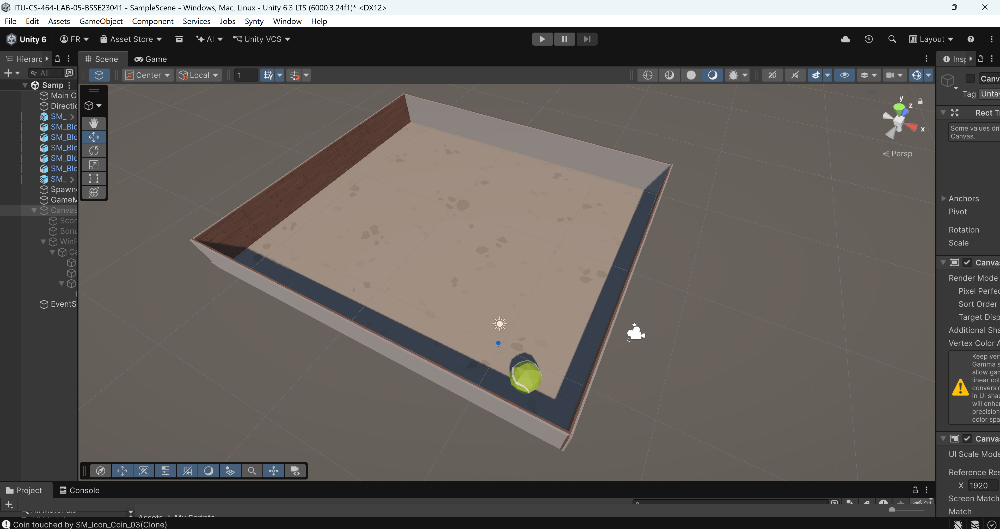
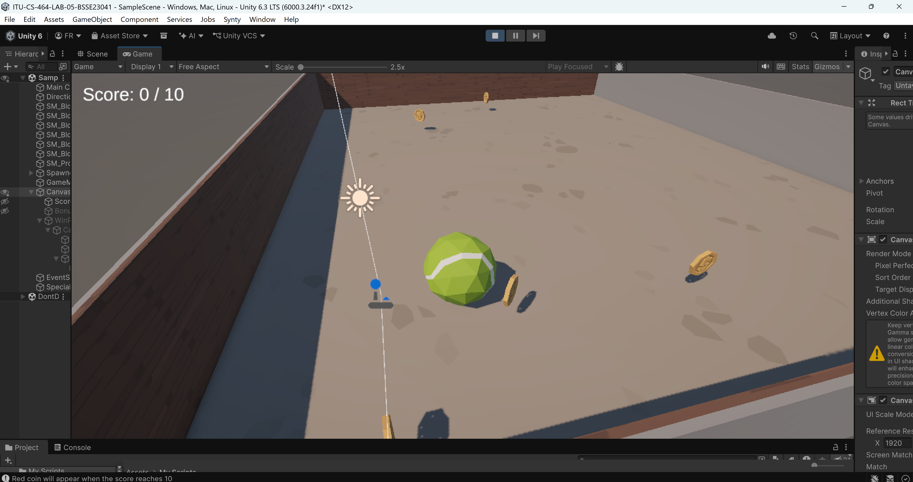
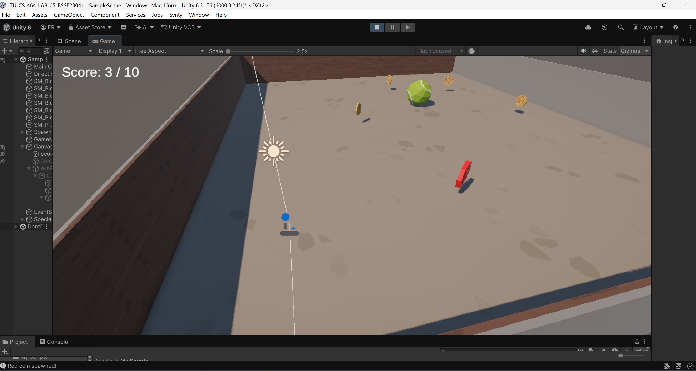
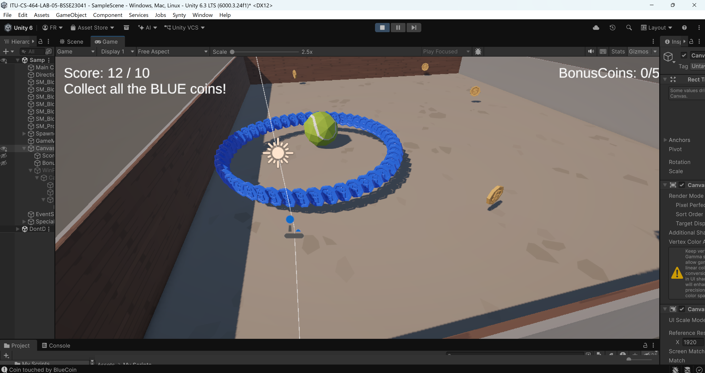
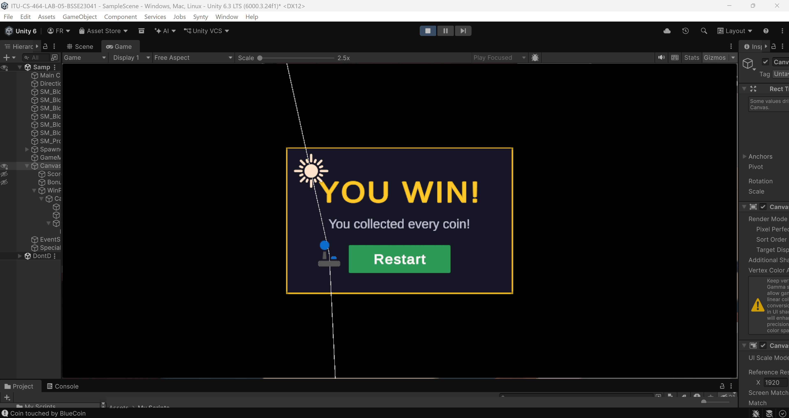

# 🎮 Unity Coin Collector Game

### Game Development | Lab 05

**Course:** CS-464 Game Development  
**University:** Information Technology University (ITU), Lahore  
**Student ID:** BSSE23041  
**Game Engine:** Unity 6  
**Language:** C#

## 🌟 About the Game

This is a simple 3D coin collection game made in Unity. The player controls a tennis ball inside a small arena surrounded by walls.

The main goal is to move around, collect coins, increase the score, and complete the game.

To make the game more interesting, different types of coins, a bonus collection round, a score counter, and a win screen with a restart button were added

## 🎥 Gameplay Video

I have recorded a short video showing how the game works, including coin collection, the bonus round, and the win screen.

▶️ **[Watch Gameplay on YouTube](https://youtu.be/eo4QiKOAv9Y)**

## 🕹️ How to Play

1. **Move the ball:** Use the movement controls to move the tennis ball around the arena.
2. **Collect gold coins:** Move towards the gold coins to collect them and increase your score.
3. **Find the red coin:** A special red coin appears at a random score between 1 and 10.
4. **Unlock blue coins:** Collecting the red coin spawns 50 blue coins in a circle around the player.
5. **Collect bonus coins:** Collect the blue coins while the bonus counter tracks your progress.
6. **Win the game:** Reach a score of 10 and collect all 50 blue coins to complete the game.
7. **Play again:** Click the Restart button on the win screen to start a new game.

## 📸 Game Screenshots

### 1. Game Arena
The 3D arena where the tennis ball moves around and collects coins.

### 2. Gold Coin Collection
Gold coins appear around the arena for the player to collect.

### 3. Special Red Coin
A red coin appears during gameplay and unlocks the bonus round.

### 4. Blue Bonus Coins
After collecting the red coin, 50 blue coins appear and the bonus counter starts tracking them.

### 5. Win Screen
The final screen appears after completing the game, with a Restart button to play again.

## 🛠️ Tools and Technologies

- **Unity 6:** Used to create the 3D game.
- **C#:** Used for player movement, coin collection, spawning, and game logic.
- **TextMeshPro:** Used to display the score and bonus counter.
- **Unity UI:** Used to create the win screen and restart button.
- **Git & GitHub:** Used to manage and submit the project.

## 📂 Main Scripts

| Script | Purpose |
|---|---|
| `Playercontroller.cs` | Handles the tennis ball movement |
| `Coin.cs` | Handles coin rotation and collection |
| `Spawner.cs` | Spawns gold, red, and blue coins |
| `GameManager.cs` | Manages score, bonus coins, winning, and restarting |
| `WinPanelAnimator.cs` | Animates the win screen |

